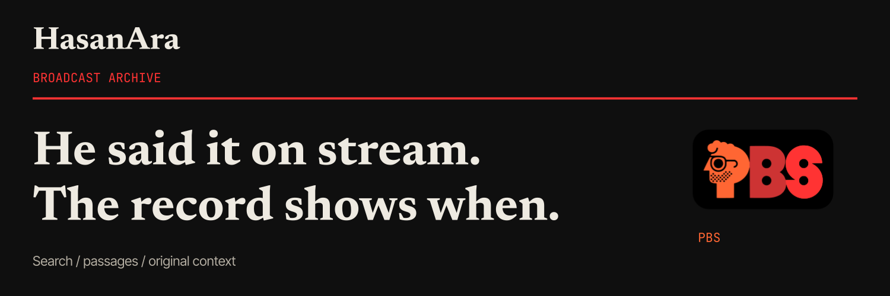

# HasanAra



**He said it on stream. The record shows when.**

HasanAra is the searchable record of the Piker Broadcasting Service: an archive
of HasanAbi broadcasts with timestamped transcripts. Search by phrase and each
result opens the original recording at its timestamp.

The transcripts are made by machine and are sometimes wrong. Check the
recording before you quote a passage. The record is also incomplete: coverage
depends on the recordings and transcripts available.

Public archive: [hasanara.tv](https://hasanara.tv)


This repository holds HasanAra's web frontend, branding, archive configuration
and deployment profile. The backend is [Rekolekt](https://github.com/subculture-collective/rekolekt),
pinned here as the `core` submodule. Backend features and fixes belong in
Rekolekt.

## Features

- Phrase search across the transcript archive. Results are grouped by broadcast
  and open the recording at the matching timestamp.
- A broadcast page with the recording beside its transcript, so a passage can be
  read with the conversation around it and previewed before it is shared.
- Passage links that open without an account.
- Explore, VOD library and timeline views for browsing the archive by period,
  with sorting and filters.
- Topic pages with first and latest mentions, top broadcasts and grouped
  results.
- Accounts (with linked sign-ins) for saved moments and saved searches.
- Clip export, when the deployment enables Rekolekt's clip worker: choose a start
  and end segment (up to two minutes) and download an MP4 with captions. The
  [clip export guide](docs/clip-exports.md) also covers handing a finished
  export to clpr for draft review.
- A community page for updates and conversations, with moderation reports.
- Administration pages for archive operators: events, periods, metadata,
  labels, chapters and users.

## Quick start

The frontend is a React and Vite app in `frontend/`, with Playwright browser
tests in `e2e/`. It needs Node 20 and a running Rekolekt API.

```bash
git clone https://github.com/subculture-collective/hasanara.git
cd hasanara
# .gitmodules uses the Gitea-relative URL; point the submodule at the public GitHub copy
git config submodule.core.url https://github.com/subculture-collective/rekolekt.git
git submodule update --init core

npm ci --prefix frontend && npm ci --prefix e2e
npm --prefix frontend run dev
```

The development server proxies `/api` to `VITE_API_PROXY_TARGET` (default
`http://localhost:41177`). Set it to wherever your Rekolekt API listens;
Rekolekt's development Compose file publishes it on port 8000. It also serves `branding/assets/` at `/branding/`, so the logo and
favicon render locally.

Checks:

```bash
npm --prefix frontend run api:check        # generated types match core/docs/api/openapi.json
npm --prefix frontend run lint
npm --prefix frontend run format:check
npm --prefix frontend run type-check
npm --prefix frontend run test:coverage
npm --prefix frontend run build && npm --prefix frontend run bundle:check
npm --prefix frontend run security:check   # fails on high or critical npm advisories
(cd e2e && npx playwright test tests/archive-smoke.spec.ts --project=chromium)
```

After adopting a new core release whose OpenAPI document changed, run
`npm --prefix frontend run api:generate`.

To validate the brand profile and the production Compose model without
secrets:

```bash
python3 -m venv .validate-venv
.validate-venv/bin/pip install -c core/constraints.txt pydantic
.validate-venv/bin/python scripts/validate.py
```

## Configuration

- `branding/brand.json`: the public brand profile (name, domains, artwork,
  social card). The API serves it at `/api/site` and the web container renders
  crawler metadata, `/social-preview.png` and `/apple-touch-icon.png` from it at
  startup.
- `frontend/.env.example`: `VITE_API_PROXY_TARGET` for the development proxy.
  Leave `VITE_API_BASE` unset in development to use the proxy.
- `docker-compose.client.yml`: the HasanAra overlay for Rekolekt's production
  Compose files. It sets `SITE_PROFILE_PATH`, `ARCHIVE_EDITORIAL_PRESET`,
  `FRONTEND_ORIGIN`, `CORS_ALLOW_ORIGINS`, the OAuth redirect URIs
  (`OAUTH_GOOGLE_REDIRECT_URI`, `OAUTH_TWITCH_REDIRECT_URI`),
  `BOOTSTRAP_ADMIN_IDENTITIES` and `CHANNEL_SYNC_URLS` (the YouTube channels the
  worker ingests).
- Secrets live in an untracked `.env.prod` on the deployment host. See
  Rekolekt's `.env.example` for the backend variables.

## Deploy

HasanAra runs as two Compose projects:

1. The backend (`hasanara` project): Rekolekt's production Compose files with
   `docker-compose.client.yml` applied on top. Backend images come from
   `release-images.json`, Rekolekt's release manifest copied unchanged. To adopt
   a new Rekolekt release, check out its `source_commit` in `core`, replace
   `release-images.json`, run `api:check`, and open a pull request.
2. The web container (`hasanara-web` project, `docker-compose.web.yml`): an
   nginx image built from `frontend/Dockerfile`. `web-image.json` records the
   image digest, source commit and `frontend/` tree.

`bin/compose-prod` wraps both:

```bash
git pull --recurse-submodules
bin/compose-prod preflight && bin/compose-prod deploy      # backend
bin/compose-prod web-preflight && bin/compose-prod deploy-web
bin/compose-prod web ps|logs|images|config
```

The preflights refuse to run when the checkout is dirty, when `core` does not
match the release manifest, or when `web-image.json` was built from a different
`frontend/` tree. [DEVELOPMENT.md](DEVELOPMENT.md) has the full deployment
reference, including how to re-export the social card.

## Project layout

| Path | Contents |
| --- | --- |
| `frontend/` | React web app, nginx config and Dockerfile |
| `e2e/` | Playwright browser tests |
| `core/` | Rekolekt submodule at the deployed release |
| `branding/` | Brand profile and artwork |
| `bin/compose-prod` | Deployment wrapper |
| `scripts/` | Profile validator, web image manifest tool, CI planner and tests |
| `docs/` | Clip exports, design system and other reference notes |

## Contributing

Open a pull request on GitHub against `main`. CI runs on every pull request: it
validates the brand profile and the production Compose contract, and when
`frontend/` changes it runs the API type check, dependency security gate, lint,
formatting, unit tests, build and bundle budget, browser tests, and a web image
build with a smoke test. Changes to search, transcripts or other backend
behavior belong in [Rekolekt](https://github.com/subculture-collective/rekolekt).

The [design system](docs/design-system.md) records the palette, typography and
assets.

HasanAra is an independent archive operated by [SUBCULT](https://subcult.tv).
Broadcasts and trademarks belong to their respective owners.

## License

[Apache License 2.0](LICENSE).
